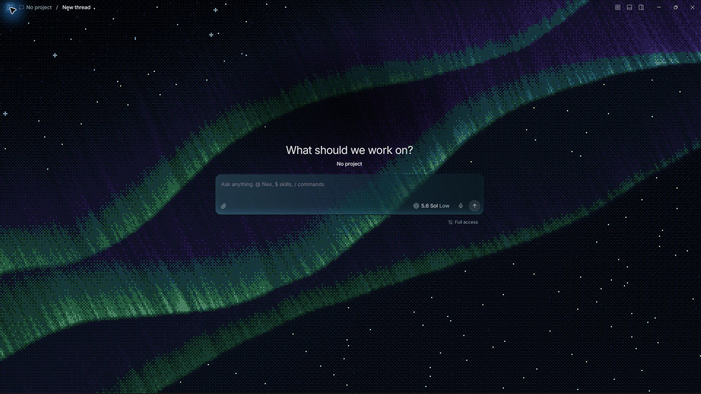

# Aurora TTY

An Arch-inspired dark theme for [T3 Code](https://t3.codes). A cyan pixel aurora glows over a black terminal-style background, while menus, panels, messages, and controls keep a translucent glass finish.



## Install

```sh
curl -fsSL https://raw.githubusercontent.com/bon4to/t3-aurora-theme/main/t3-aurora.json -o t3-aurora.json
t3 theme set t3-aurora.json
```

T3 switches to Aurora TTY immediately. If it does not appear, reload T3 Code with `Ctrl+R`. To go back, choose another theme in the theme picker or run `t3 theme set t3-chat`.

### Let your agent install it

Paste this into a T3 Code thread:

> Install Aurora TTY from https://github.com/bon4to/t3-aurora-theme. Follow the "Instructions for agents" section of its README.

### Instructions for agents

1. Download `https://raw.githubusercontent.com/bon4to/t3-aurora-theme/main/t3-aurora.json`.
2. If the `t3` command is available, run `t3 theme set <path to t3-aurora.json>`.
3. Otherwise call the `t3_theme_set` tool with `themeId: "t3-aurora"` and the file's JSON as `theme`.
4. Do not edit the generated JSON. The background artwork is embedded in it.

## Requirements

- A recent T3 Code Nightly (November 2026 or later).
- Works in the desktop app and browser. The phone app does not use themes.

## Notes

- Aurora TTY is dark only.
- The translucent look follows the Glass opacity slider in Settings › Appearance.
- The pixel artwork fills the window at any size.
- The composer and code use JetBrains Mono, Cascadia Code, Consolas, or the closest available monospace font.
- If a future T3 update changes its layout, some details may fall back to T3's default styling without breaking the app.

## Build it yourself

`theme.css` contains the styles, `colors.json` contains the palette, and `t3-aurora.png` is the source artwork. Build the self-contained theme with Node.js:

```sh
node build.mjs
```

## License

[MIT](LICENSE)
