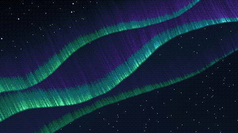

# T3 Aurora

A dark, Arch-inspired T3 Code theme with a pixel-art aurora background, translucent panels, cyan highlights, and terminal-style typography.



## Install

1. Download `t3-aurora.json` and `t3-aurora.png` into the same directory.
2. Open that directory in a terminal.
3. Run:

   ```sh
   t3 theme set t3-aurora.json
   ```

4. Reload T3 Code with `Ctrl+R` if the theme does not appear immediately.

## Files

- `t3-aurora.json` — installable T3 theme
- `t3-aurora.png` — background artwork
- `theme.css` — readable CSS source
- `colors.json` — color palette source

## License

MIT
